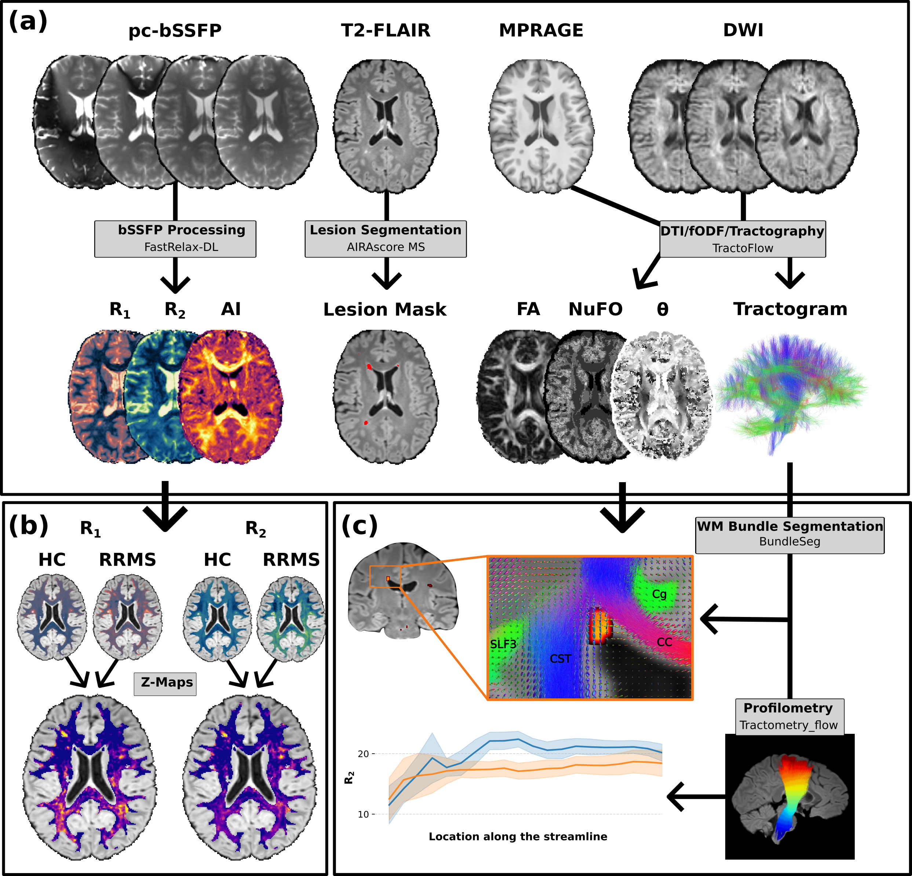

# bssfp-qmri-ms

[](https://onlinelibrary.wiley.com/doi/10.1002/jmri.70594) [](environment.yml)

Code for the figures from the manuscript on phase-cycled balanced Steady-State Free Precession (pc-bSSFP) quantitative MRI at 3T in relapsing-remitting multiple sclerosis. The associated article is published in the [Journal of Magnetic Resonance Imaging](https://onlinelibrary.wiley.com/doi/10.1002/jmri.70594).

[](figure1.png)

## Repository Structure

```
.
├── dat/                         # Data
│   ├── 251217-b_get_gender_age_participants/
│   └── paper_figures/           # Pre-computed results for figures & tables
├── fig/                         # Generated figures (SVG)
│   ├── figure1_axial_images/
│   ├── figure2_reproducibility/
│   ├── figure3_orient_dep_hc_vs_rrms/
│   ├── figure4_zmaps/
│   ├── figure5_profilometry/
│   └── figure6_roi_analysis_and_LMMs/
└── src/
    ├── colorresourcespy/        # Relaxation colormaps (Lipari/Navia)
    ├── figures/                 # Figure generation scripts
    │   ├── figure1_axial_images.py
    │   ├── figure2_reproducibility.py
    │   ├── figure3_orient_dep_hc_vs_rrms.py
    │   ├── figure4_zmaps.py
    │   ├── figure5_profilometry.py
    │   ├── figure6_roi_analysis_and_LMMs.py
    │   ├── SI_figure_1_QC_MS_qualitatively.py
    │   └── SI_figure_2_lesion_volume_RRMS.py
    └── utils/                   # Shared utilities
        ├── __init__.py
        ├── defaults.yaml        # Project configuration
        ├── dti.py               # DTI angle computation
        ├── paper_figure_helpers.py  # Subject-space asset loading, ROI masks, z-maps
        ├── paper_meta.py        # Subject ID mapping, demographics
        ├── paper_stats.py       # FDR, Cohen's d, LMMs, group tests
        ├── paths.py             # Project path definitions
        └── plotting.py          # Matplotlib style configuration
```

## How to Reproduce the Figures

Activate the conda environment and run each figure script from the **project root**:

```bash
conda env create -f environment.yml
conda activate bssfp-qmri-ms
```

For example, to generate Figure 1 (axial slices):

```bash
# Figure 1: Axial slices
python src/figures/figure1_axial_images.py
```

IMPORTANT: The full dataset is not shared in this repository due to data protection. Please use the precomputed results in `dat/paper_figures/` to reproduce the figures. The scripts will automatically load these cached results if the full dataset is not available. 


## How to Cite

If you use this code or data, please cite:

```bibtex
@article{https://doi.org/10.1002/jmri.70594,
author = {Birk, Florian and Bender, Benjamin and Tesh, Hamzeh and Deshmane, Anagha and Fabian, Maris M. and Kowarik, Markus C. and Lindig, Tobias and Ernemann, Ulrike and Scheffler, Klaus and Heule, Rahel},
title = {Multi-Parametric Phase-Cycled Balanced Steady-State Free Precession Brain Tissue Characterization in Relapsing-Remitting Multiple Sclerosis},
journal = {Journal of Magnetic Resonance Imaging},
volume = {n/a},
number = {n/a},
pages = {},
keywords = {anisotropy, non-lesional white matter, phase-cycled balanced steady-state free precession (pc-bSSFP), profilometry, relapsing-remitting multiple sclerosis (RRMS), relaxometry},
doi = {https://doi.org/10.1002/jmri.70594},
url = {https://onlinelibrary.wiley.com/doi/abs/10.1002/jmri.70594},
eprint = {https://onlinelibrary.wiley.com/doi/pdf/10.1002/jmri.70594},
abstract = {ABSTRACT Background Time-efficient phase-cycled balanced steady-state free precession (pc-bSSFP) imaging is a novel microstructure- and myelin-sensitive approach for multi-parametric brain tissue characterization not yet evaluated in demyelinating diseases such as multiple sclerosis (MS). Purpose To evaluate quantitative relaxometry metrics in white matter (WM) and gray matter (GM) of relapsing-remitting multiple sclerosis (RRMS) and healthy control (HC) cohorts using a multi-parametric pc-bSSFP framework. Study Type Prospective and retrospective, observational. Population Twenty RRMS patients (34.5 ± 5.9 years, female 15/20) and 10 HC subjects (33.4 ± 6.9 years, female 5/10). Field Strength/Sequence 3 T; T1-weighted magnetization-prepared rapid gradient-echo, T2-weighted fluid-attenuated inversion recovery, pc-bSSFP, B1+ mapping, single-shot spin-echo echo-planar-imaging diffusion tensor imaging (DTI). Assessment R1, R2, and the bSSFP asymmetry index (AI) were compared between RRMS and HC across selected WM and GM regions of interest (ROIs). DTI-derived fiber-to-field angle, number of fiber orientations, and fractional anisotropy were used for parameter anisotropy analysis. Statistical Tests Linear mixed-effects models tested group, ROI, and group-by-ROI effects for each metric. Anisotropy differences between cohorts were assessed with two-sided t-tests. ROI and anisotropy tests employed false discovery rate correction with significance set at pcorr < 0.05. Results Significant group, ROI, and group-by-ROI effects were found for R1 (β = −0.16) and R2 (β = −2.84). The ROI effect was significant for AI while the group (p = 0.450) and group-by-ROI (p = 0.747) effects were non-significant. Age and sex covariates did not reach significance (Age: p = [0.563, 0.705, 0.591], Gender: p = [0.839, 0.822, 0.179], for [R1, R2, AI]). Fourteen of 16 ROIs showed significantly lower R1 and R2 (d = −4.25 to −0.85) in RRMS than HC. All ROIs remained non-significant for AI. R2 (pcorr ≥ 0.055) and AI (pcorr ≥ 0.108) anisotropy comparison between RRMS and HC groups did not reach significance. Data Conclusion Phase-cycled bSSFP relaxometry showed WM-predominant differences in RRMS, with additional whole-brain assessment including gray matter. Evidence Level 2. Technical Efficacy Stage 1.}
}
```
